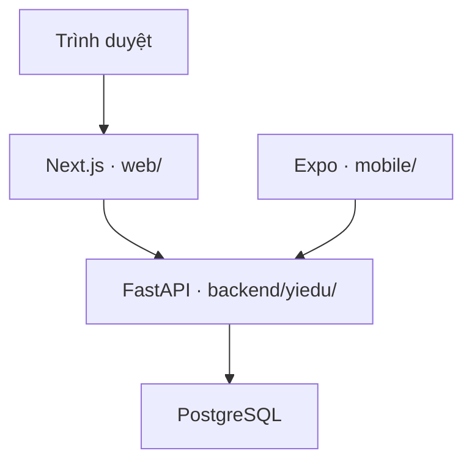

# Cấu trúc dự án YiEdu — tài liệu cho developer

Cập nhật 25/10/2026, đối chiếu quản trị/thương mại 0.9, dựa trên commit
[`fae6812`](https://github.com/tuantruong1368/yiedu/commit/fae6812b30dab92f66fe9b882d75f75b9bd5d185) đã qua CI.
Danh mục bên dưới bao phủ toàn bộ **286 file được quản lý bằng Git** sau lần cập nhật tài liệu.
Có 76 thư mục chứa source/tài liệu. Các file mới ở phần bổ sung 0.6/0.7/0.8/0.9 cuối tài liệu.
Các thư mục build/dependency/backup sinh ở máy developer được giải thích riêng ở mục 6.

## 1. Đọc tài liệu này để làm gì?

Sau khi đọc, developer cần biết ứng dụng khởi động ở đâu, request đi qua những thành phần nào,
file nào phụ trách từng chức năng và phải kiểm tra gì khi thay đổi. Đọc theo thứ tự:

1. [Trạng thái thực tế](../product/status.md) và [ma trận 0.3](../product/release-0.3.md).
2. Mục 2–4 bên dưới để hiểu runtime, tenant và ranh giới module.
3. Mục 5 để tra cứu từng file; không cần học thuộc toàn bộ ngay.
4. Mục 7–9 để lần theo tính năng, thực hành và tham gia phát triển.
5. [Quy trình đóng góp](https://github.com/tuantruong1368/yiedu/blob/main/CONTRIBUTING.md) để nhận việc và bàn giao.

Đặc tả tương lai không đồng nghĩa tính năng đã chạy. Khi tài liệu thiết kế có nội dung lịch sử,
đối chiếu status/release-0.3 và code; không suy ra đã có OAuth, thanh toán, marketplace bán hàng
hoặc plugin runtime chỉ vì đã có file mang tên tương ứng.

## 2. Tổng thể: một repo, ba ứng dụng và một Handbook

| Thành phần | Thư mục chính | Vai trò | Chạy ở đâu? |
|---|---|---|---|
| Web | `web/` | Marketing, GrapesJS builder, tenant public/admin/learn; BFF chuyển API | Next.js server và trình duyệt |
| API | `backend/yiedu/` | Auth, quyền tenant, nghiệp vụ, database, export | FastAPI/Uvicorn |
| App | `mobile/` | Học bằng tài khoản tenant qua cùng API | Expo/React Native trên iOS/Android |
| Handbook | `handbook/` | Tài liệu sản phẩm, quy trình P0–P9 và hướng dẫn | MkDocs, không phải một phần website khách hàng |

Sơ đồ sau được GitHub render bằng Mermaid; khi trình đọc chưa hỗ trợ Mermaid, dùng bảng vai trò ở trên và mô tả luồng bên dưới.

Trình duyệt gọi `/api/v1/*` trên Next.js; BFF chuyển tiếp đến FastAPI.
Server Components lấy dữ liệu public trực tiếp từ FastAPI qua `publicApi()`.
Mobile gọi FastAPI trực tiếp bằng bearer token; không đi qua BFF của website.
Mã trong `web/` không truy cập PostgreSQL trực tiếp. Các thư mục `handbook/`, `contracts/`
và `extensions/examples/` không phải những service độc lập cần bật trong Compose.

### 2.1. Khi chạy Docker Compose

Compose tạo database → chạy service `migrate` đến revision mới nhất → API chờ migration thành công
và được kiểm tra readiness → web chờ API healthy. `migrate` là tiến trình chạy xong rồi thoát,
không phải server phải luôn ở trạng thái Up. Stack thường dùng:

| Service | Cổng trên máy local | Dữ liệu/process |
|---|---|---|
| `db` | `127.0.0.1:5432` | PostgreSQL 18; named volume `postgres18_data`, mount `/var/lib/postgresql` |
| `migrate` | Không mở cổng | `alembic upgrade head` |
| `api` | `127.0.0.1:8000` | `uvicorn yiedu.main:app`; `/docs`, `/health/live`, `/health/ready` |
| `web` | `127.0.0.1:3000` | Next standalone server; gọi `http://api:8000` trong mạng Compose |

Tên volume thật thường có tiền tố Compose project. PostgreSQL 17 cũ dùng volume `postgres_data`
riêng và chỉ đọc qua cấu hình legacy khi nâng cấp. Không gắn dữ liệu 17 trực tiếp vào image 18.
Xem [hướng dẫn nâng cấp](upgrade-latest.md) nếu máy đã chạy bản cũ.
Handbook (`mkdocs serve`, cổng 8001) và mobile không được khởi động bởi Compose hiện tại.

### 2.2. Tenant, workspace và người dùng

Tenant là hệ thống e-learning của khách hàng. Workspace là bản thiết kế đang chỉnh trong builder;
xuất bản workspace tạo/cập nhật tenant. Hiện các tenant dùng chung code, DB và bảng;
những bảng thuộc tenant có `tenant_id`, quyền được kiểm tra bằng membership/role ở API.
Không có folder code/container/database tự sinh riêng cho mỗi tenant khi bấm publish.

Một user có thể có nhiều membership ở nhiều tenant. `slug` phục vụ URL; `tenant_id` là ID nội bộ.
`/t/<slug>` và hostname tenant đều được đưa về cùng runtime. Hostname rewrite không tự tạo DNS/TLS.
RLS và một số ràng buộc tenant ở cấp database vẫn là phần cần hoàn thiện trước production.

## 3. Bản đồ các thư mục

Các đường dẫn đều tính từ gốc repo. Những thư mục con chứa route có chức năng theo Next.js:
`[id]`/`[slug]` là tham số, `[...path]` nhận nhiều đoạn URL, `page.tsx` tạo trang và `route.ts` tạo HTTP handler.

| Thư mục | Trách nhiệm |
|---|---|
| `.github/` | Cấu hình cộng tác trên GitHub và workflow tự động. |
| `.github/ISSUE_TEMPLATE/` | Các form tạo issue. |
| `.github/workflows/` | Workflow GitHub Actions. |
| `backend/` | Nguồn API Python và lịch sử migration. |
| `backend/migrations/` | Môi trường Alembic và template revision. |
| `backend/migrations/versions/` | Lịch sử biến đổi schema; đã áp dụng thì thêm revision thay vì sửa lịch sử. |
| `backend/yiedu/` | Package import được dưới tên yiedu nhờ cài từ pyproject.toml. |
| `backend/yiedu/extensions/` | Hợp đồng/validator metadata extension; chưa có installer hoặc execution host. |
| `contracts/` | Hợp đồng máy đọc để các công cụ/developer thống nhất metadata. |
| `extensions/` | Không gian ví dụ extension; khác namespace validator backend/yiedu/extensions. |
| `extensions/examples/` | Ba ví dụ chỉ có metadata và README. |
| `extensions/examples/certificates-component/` | Ví dụ loại component. |
| `extensions/examples/completion-plugin/` | Ví dụ loại plugin. |
| `extensions/examples/training-template/` | Ví dụ loại template. |
| `handbook/` | Nguồn Markdown của Developer Handbook. |
| `handbook/forms/` | Biểu mẫu trống dùng khi thực hiện công việc. |
| `handbook/guides/` | Hướng dẫn thao tác, onboarding và tra cứu code. |
| `handbook/phases/` | Quy trình vòng đời P0–P9, tách với hồ sơ sản phẩm. |
| `handbook/phases/p0-initiation/` | Tài liệu hướng dẫn giai đoạn P0; xem bảng từng file ở mục 5.12. |
| `handbook/phases/p1-discovery/` | Tài liệu hướng dẫn giai đoạn P1; xem bảng từng file ở mục 5.12. |
| `handbook/phases/p2-planning/` | Tài liệu hướng dẫn giai đoạn P2; xem bảng từng file ở mục 5.12. |
| `handbook/phases/p3-requirements/` | Tài liệu hướng dẫn giai đoạn P3; xem bảng từng file ở mục 5.12. |
| `handbook/phases/p4-design/` | Tài liệu hướng dẫn giai đoạn P4; xem bảng từng file ở mục 5.12. |
| `handbook/phases/p5-development/` | Tài liệu hướng dẫn giai đoạn P5; xem bảng từng file ở mục 5.12. |
| `handbook/phases/p6-testing/` | Tài liệu hướng dẫn giai đoạn P6; xem bảng từng file ở mục 5.12. |
| `handbook/phases/p7-acceptance/` | Tài liệu hướng dẫn giai đoạn P7; xem bảng từng file ở mục 5.12. |
| `handbook/phases/p8-release/` | Tài liệu hướng dẫn giai đoạn P8; xem bảng từng file ở mục 5.12. |
| `handbook/phases/p9-operations/` | Tài liệu hướng dẫn giai đoạn P9; xem bảng từng file ở mục 5.12. |
| `handbook/product/` | Yêu cầu, thiết kế, backlog, giới hạn và bằng chứng triển khai YiEdu. |
| `handbook/product/changes/` | Hồ sơ quản lý thay đổi phạm vi. |
| `mobile/` | Ứng dụng học iOS/Android dùng Expo/React Native. |
| `scripts/` | CLI hỗ trợ local, kiểm tra contract/docs, export/restore và nâng cấp DB. |
| `tests/` | Kiểm thử Python và fixture chuyển database. |
| `web/` | Ứng dụng Next.js, dependency và cấu hình build riêng. |
| `web/app/` | Route App Router, layout và global CSS. |
| `web/app/api/` | Route HTTP phía Next làm BFF. |
| `web/app/api/[...path]/` | Handler bắt nhiều đoạn URL /api/v1/* để chuyển sang FastAPI. |
| `web/app/builder/` | Nhóm route editor. |
| `web/app/builder/[id]/` | Trang editor cho một workspace ID. |
| `web/app/dashboard/` | Dashboard workspace và tenant của người dùng. |
| `web/app/developer/` | Portal gửi metadata package. |
| `web/app/login/` | Trang đăng nhập. |
| `web/app/marketplace/` | Trang catalog extension tích hợp. |
| `web/app/register/` | Trang đăng ký. |
| `web/app/t/` | Nhóm runtime tenant. |
| `web/app/t/[slug]/` | Trang public của tenant theo slug. |
| `web/app/t/[slug]/administrator/` | Trang quản trị cùng tenant. |
| `web/app/t/[slug]/learn/` | Trang học cùng tenant. |
| `web/components/` | Các màn hình và component React dùng bởi route. |
| `web/lib/` | Helper gọi API và chuẩn hóa slug. |
| `web/tests/` | Kiểm thử trình duyệt Playwright. |

| Thư mục bổ sung 0.4 | Trách nhiệm |
|---|---|
| `extensions/examples/learning-tools/` | Ví dụ package đóng góp gadget và lesson tool. |
| `web/app/t/[slug]/p/` | Nhóm route trang con tenant. |
| `web/app/t/[slug]/p/[page]/` | Trang nội dung tenant theo page slug. |
| `web/components/authoring/` | Runtime sandbox cho page HTML/CSS. |
| `web/components/lesson/` | Rich editor và viewer lesson. |
| `web/lib/authoring/` | Kiểu document, sanitizer client và registry gadget/tool. |
| `web/lib/i18n/` | Locale và dictionary dùng chung client/server. |

## 4. Ranh giới module cần hiểu trước khi sửa

| Khái niệm | Định nghĩa trong repo | Dễ nhầm với |
|---|---|---|
| ORM model | `models.py` mô tả bảng/quan hệ cho SQLAlchemy | Request schema Pydantic |
| Request/response schema | `schemas.py`, `product_schemas.py` kiểm input/output | Migration thay đổi DB |
| Migration | File revision Alembic biến đổi schema thật | Sửa model rồi mong DB tự đổi |
| BFF | Next route chuyển request, cookie và response | Nơi xử lý nghiệp vụ/quyền tenant |
| Puck component legacy | Block giao diện cũ trong `page-blocks.tsx` | Package plugin của bên thứ ba |
| Extension manifest | Metadata hợp đồng package | Code extension được cài/chạy |
| Tenant snapshot | Dữ liệu có giới hạn của một tenant để standalone restore | Backup PostgreSQL toàn hệ thống giữ nguyên tài khoản |

`product.py`, `admin-screen.tsx` và `mobile/App.tsx` hiện chứa nhiều trách nhiệm trong cùng file.
Chưa có cấu trúc service/repository/module theo domain hoàn chỉnh. Developer nên thêm thay đổi nhỏ có test;
nếu tách module, đề xuất rõ phạm vi và giữ hợp đồng API. Không mô tả các thư mục services/repositories
hoặc worker/marketplace installer như thể chúng đã tồn tại.

## 5. Chức năng từng file được quản lý bằng Git

Các bảng liệt kê đường dẫn đầy đủ từ gốc repo. Liên kết “mở” dẫn tới tài liệu trong Handbook hoặc mã nguồn trên GitHub.
Khi đọc offline, dùng đường dẫn ở cột File để mở nguồn trong workspace.

### 5.1. File ở gốc repository

| File | Chức năng và lưu ý |
|---|---|
| `README.md` [mở](https://github.com/tuantruong1368/yiedu/blob/main/README.md) | Điểm vào dự án: phạm vi chạy được, Docker/local, mobile, Handbook và kiểm tra. |
| `CONTRIBUTING.md` [mở](https://github.com/tuantruong1368/yiedu/blob/main/CONTRIBUTING.md) | Lộ trình onboarding developer, cách nhận việc, tạo nhánh/PR và tiêu chí bàn giao. |
| `AGENTS.md` [mở](https://github.com/tuantruong1368/yiedu/blob/main/AGENTS.md) | Quy tắc dành cho tác nhân AI làm việc trong repo; developer cần hiểu để phối hợp cùng AI. |
| `.env.example` [mở](https://github.com/tuantruong1368/yiedu/blob/main/.env.example) | Tên biến môi trường và giá trị mẫu. Sao chép/cấu hình hoặc dùng bootstrap; không phải credential thật. |
| `.gitignore` [mở](https://github.com/tuantruong1368/yiedu/blob/main/.gitignore) | Loại secret, venv, dependency cài local, output build/test và backup khỏi Git. |
| `.dockerignore` [mở](https://github.com/tuantruong1368/yiedu/blob/main/.dockerignore) | Loại secret, backup và output local khỏi build context của image API. |
| `.python-version` [mở](https://github.com/tuantruong1368/yiedu/blob/main/.python-version) | Phiên bản Python mục tiêu cho công cụ quản lý Python. |
| `.node-version` [mở](https://github.com/tuantruong1368/yiedu/blob/main/.node-version) | Phiên bản Node mục tiêu cho công cụ đọc file này. |
| `.nvmrc` [mở](https://github.com/tuantruong1368/yiedu/blob/main/.nvmrc) | Phiên bản Node dùng với nvm; cần đồng bộ với .node-version, Docker và CI. |
| `pyproject.toml` [mở](https://github.com/tuantruong1368/yiedu/blob/main/pyproject.toml) | Metadata/package Python, dependency trực tiếp, yêu cầu interpreter, cấu hình pytest và Ruff. Package discovery trỏ vào backend/. |
| `requirements.lock` [mở](https://github.com/tuantruong1368/yiedu/blob/main/requirements.lock) | Bộ phiên bản Python đã resolve và pin để cài đồng nhất. Là lock chưa có hash; không tự sửa một dòng mà bỏ qua tương thích. |
| `Dockerfile` [mở](https://github.com/tuantruong1368/yiedu/blob/main/Dockerfile) | Build image API, kèm nguồn cần cho ZIP export; cài dependency, chạy bằng user không phải root và khởi động Uvicorn. |
| `compose.yaml` [mở](https://github.com/tuantruong1368/yiedu/blob/main/compose.yaml) | Stack local gồm db, migrate, api, web; env, port, volume và thứ tự chờ health/migration. |
| `compose.pg17.yaml` [mở](https://github.com/tuantruong1368/yiedu/blob/main/compose.pg17.yaml) | Cấu hình DB PostgreSQL 17 dùng riêng cho chuyển dữ liệu từ bản cũ; không phải DB thứ hai cho vận hành thường ngày. |
| `alembic.ini` [mở](https://github.com/tuantruong1368/yiedu/blob/main/alembic.ini) | Cấu hình Alembic: thư mục migration và logging. URL kết nối lấy qua cấu hình Python. |
| `mkdocs.yml` [mở](https://github.com/tuantruong1368/yiedu/blob/main/mkdocs.yml) | Cấu hình Handbook: theme Material, menu, Markdown extensions và thư mục output .build/handbook. |

### 5.2. GitHub và CI

| File | Chức năng và lưu ý |
|---|---|
| `.github/ISSUE_TEMPLATE/task.yml` [mở](https://github.com/tuantruong1368/yiedu/blob/main/.github/ISSUE_TEMPLATE/task.yml) | Form issue để ghi công việc, đầu ra và điều kiện chấp nhận. |
| `.github/pull_request_template.md` [mở](https://github.com/tuantruong1368/yiedu/blob/main/.github/pull_request_template.md) | Mẫu PR để người sửa trình bày thay đổi và bằng chứng kiểm tra. |
| `.github/workflows/ci.yml` [mở](https://github.com/tuantruong1368/yiedu/blob/main/.github/workflows/ci.yml) | Workflow push/PR: product (migration/API/web/browser), mobile, Compose và chuyển PostgreSQL 17 → 18. Chạy test trên môi trường CI; không deploy production. |

### 5.3. Backend và migration

| File | Chức năng và lưu ý |
|---|---|
| `backend/yiedu/__init__.py` [mở](https://github.com/tuantruong1368/yiedu/blob/main/backend/yiedu/__init__.py) | Đánh dấu package Python yiedu; hiện không chứa nghiệp vụ. |
| `backend/yiedu/main.py` [mở](https://github.com/tuantruong1368/yiedu/blob/main/backend/yiedu/main.py) | Entry point yiedu.main:app. Tạo FastAPI, gắn product router, CORS/CSRF/security headers, health và API platform-admin cũ dùng X-Admin-Key. |
| `backend/yiedu/config.py` [mở](https://github.com/tuantruong1368/yiedu/blob/main/backend/yiedu/config.py) | Đọc/kiểm tra env bằng Pydantic Settings; DB, admin secret, mode saas/standalone, domain, cookie và origin. get_settings được cache. |
| `backend/yiedu/db.py` [mở](https://github.com/tuantruong1368/yiedu/blob/main/backend/yiedu/db.py) | Tạo/cached SQLAlchemy Engine và cung cấp Session cho mỗi request bằng dependency get_session. |
| `backend/yiedu/models.py` [mở](https://github.com/tuantruong1368/yiedu/blob/main/backend/yiedu/models.py) | ORM PostgreSQL identity/tenant/workspace/learning/extension/audit; lesson có document/translations JSONB từ revision 0003. |
| `backend/yiedu/schemas.py` [mở](https://github.com/tuantruong1368/yiedu/blob/main/backend/yiedu/schemas.py) | Pydantic request/response cho API admin nền và kiểu dùng chung như Name, TenantSlug. Schema API không tự tạo bảng DB. |
| `backend/yiedu/product_schemas.py` [mở](https://github.com/tuantruong1368/yiedu/blob/main/backend/yiedu/product_schemas.py) | Validate request cũ/mới: SiteDocument 2.0/Puck legacy, lesson rich document/translations và nghiệp vụ sản phẩm. |
| `backend/yiedu/auth.py` [mở](https://github.com/tuantruong1368/yiedu/blob/main/backend/yiedu/auth.py) | Băm mật khẩu scrypt, session token ngẫu nhiên lưu dạng digest, cookie web/bearer native, xác định user và kiểm membership/role. |
| `backend/yiedu/catalog.py` [mở](https://github.com/tuantruong1368/yiedu/blob/main/backend/yiedu/catalog.py) | Catalog template/extension first-party và dữ liệu trang khởi tạo. Là dữ liệu tích hợp sẵn, chưa phải trình nạp package của developer bên ngoài. |
| `backend/yiedu/product.py` [mở](https://github.com/tuantruong1368/yiedu/blob/main/backend/yiedu/product.py) | Router /api/v1 cho hành trình sản phẩm. Hiện tập trung nhiều nghiệp vụ trong một file: auth, builder/publish, runtime học, quản trị, export và metadata developer. |
| `backend/yiedu/portable.py` [mở](https://github.com/tuantruong1368/yiedu/blob/main/backend/yiedu/portable.py) | Tạo snapshot theo tenant và ZIP nguồn theo allowlist, checksum manifest; loại password hash/session/secret. Không phải gói update có chữ ký. |
| `backend/yiedu/extensions/__init__.py` [mở](https://github.com/tuantruong1368/yiedu/blob/main/backend/yiedu/extensions/__init__.py) | Đánh dấu namespace Python cho mã hợp đồng extension. |
| `backend/yiedu/extensions/manifest.py` [mở](https://github.com/tuantruong1368/yiedu/blob/main/backend/yiedu/extensions/manifest.py) | Manifest package và editor_contributions (page-gadget/lesson-tool, license/props_schema); metadata không cấp quyền chạy code. |
| `backend/migrations/env.py` [mở](https://github.com/tuantruong1368/yiedu/blob/main/backend/migrations/env.py) | Nối Alembic với settings, Engine và Base.metadata; hỗ trợ chế độ online/offline và kiểm drift. |
| `backend/migrations/script.py.mako` [mở](https://github.com/tuantruong1368/yiedu/blob/main/backend/migrations/script.py.mako) | Template Mako dùng khi Alembic tạo file revision mới. |
| `backend/migrations/versions/0001_initial.py` [mở](https://github.com/tuantruong1368/yiedu/blob/main/backend/migrations/versions/0001_initial.py) | Revision nền: tạo cấu trúc tenant/course ban đầu; có upgrade/downgrade. |
| `backend/migrations/versions/0002_product.py` [mở](https://github.com/tuantruong1368/yiedu/blob/main/backend/migrations/versions/0002_product.py) | Revision mở rộng cho sản phẩm 0.3: identity, builder, nội dung học, tiến độ, metadata extension và audit; đồng thời bổ sung cột tenant/course. |

### 5.4. Web: cấu hình và công cụ

| File | Chức năng và lưu ý |
|---|---|
| `web/package.json` [mở](https://github.com/tuantruong1368/yiedu/blob/main/web/package.json) | Dependency React/Next/Puck, phiên bản Node/npm và scripts dev, build, start, typecheck, test:e2e. |
| `web/package-lock.json` [mở](https://github.com/tuantruong1368/yiedu/blob/main/web/package-lock.json) | Cây dependency npm đã resolve cho web. Commit cùng package.json; cài bằng npm ci. |
| `web/tsconfig.json` [mở](https://github.com/tuantruong1368/yiedu/blob/main/web/tsconfig.json) | Cấu hình TypeScript và alias import @/ cho web. |
| `web/next-env.d.ts` [mở](https://github.com/tuantruong1368/yiedu/blob/main/web/next-env.d.ts) | Khai báo type Next.js do framework quản lý; thường không chỉnh tay. |
| `web/next.config.ts` [mở](https://github.com/tuantruong1368/yiedu/blob/main/web/next.config.ts) | Cấu hình Next, gồm output standalone để chạy container và tắt powered-by header. |
| `web/Dockerfile` [mở](https://github.com/tuantruong1368/yiedu/blob/main/web/Dockerfile) | Build web nhiều stage, cài npm đã pin, tạo Next standalone rồi chạy server.js bằng user node. |
| `web/.dockerignore` [mở](https://github.com/tuantruong1368/yiedu/blob/main/web/.dockerignore) | Loại dependency/build output local khỏi web build context. |
| `web/playwright.config.ts` [mở](https://github.com/tuantruong1368/yiedu/blob/main/web/playwright.config.ts) | Cấu hình browser test: baseURL, Chromium, khởi động web server, timeout và executable override cho môi trường kiểm tra. |
| `web/proxy.ts` [mở](https://github.com/tuantruong1368/yiedu/blob/main/web/proxy.ts) | Rewrite hostname tenant về /t/<slug>, giữ các route platform và loại API/static khỏi matcher. Không tạo DNS/TLS hoặc quyết định quyền người dùng. |
| `web/lib/api.ts` [mở](https://github.com/tuantruong1368/yiedu/blob/main/web/lib/api.ts) | api() gọi BFF cùng origin bằng cookie; publicApi() gọi FastAPI từ server với no-store; có slugify. API_INTERNAL_URL là địa chỉ nội bộ phía server. |
| `web/tests/journey.spec.ts` [mở](https://github.com/tuantruong1368/yiedu/blob/main/web/tests/journey.spec.ts) | Playwright kiểm tra hành trình owner → builder/publish → khóa học/bài học/extension/ZIP → learner/enroll/complete; chụp screenshot bằng chứng. |

### 5.5. Web: route và URL

| File | Chức năng và lưu ý |
|---|---|
| `web/app/layout.tsx` [mở](https://github.com/tuantruong1368/yiedu/blob/main/web/app/layout.tsx) | Root HTML/layout, LocaleProvider và metadata ngôn ngữ từ cookie; import global CSS. |
| `web/app/globals.css` [mở](https://github.com/tuantruong1368/yiedu/blob/main/web/app/globals.css) | CSS toàn website: màu sắc, bố cục, component, responsive, admin và trang học. |
| `web/app/page.tsx` [mở](https://github.com/tuantruong1368/yiedu/blob/main/web/app/page.tsx) | URL /. Trang marketing/template ở mode saas; mode standalone có thể render tenant duy nhất tại gốc. |
| `web/app/login/page.tsx` [mở](https://github.com/tuantruong1368/yiedu/blob/main/web/app/login/page.tsx) | URL /login. Đọc template/site trong query rồi truyền sang AuthScreen đăng nhập. |
| `web/app/register/page.tsx` [mở](https://github.com/tuantruong1368/yiedu/blob/main/web/app/register/page.tsx) | URL /register. Dùng AuthScreen ở chế độ đăng ký, giữ ngữ cảnh template/tenant. |
| `web/app/dashboard/page.tsx` [mở](https://github.com/tuantruong1368/yiedu/blob/main/web/app/dashboard/page.tsx) | URL /dashboard. Điểm vào danh sách hệ thống/workspace của người dùng. |
| `web/app/builder/[id]/page.tsx` [mở](https://github.com/tuantruong1368/yiedu/blob/main/web/app/builder/%5Bid%5D/page.tsx) | URL /builder/<workspace-id>. Lấy tham số id rồi render builder. |
| `web/app/developer/page.tsx` [mở](https://github.com/tuantruong1368/yiedu/blob/main/web/app/developer/page.tsx) | URL /developer. Điểm vào developer metadata portal; chưa có publish artifact hoặc bán package. |
| `web/app/marketplace/page.tsx` [mở](https://github.com/tuantruong1368/yiedu/blob/main/web/app/marketplace/page.tsx) | URL /marketplace. Render catalog extension tích hợp; hiện đọc /catalog/extensions, không phải luồng checkout của endpoint /marketplace. |
| `web/app/t/[slug]/page.tsx` [mở](https://github.com/tuantruong1368/yiedu/blob/main/web/app/t/%5Bslug%5D/page.tsx) | URL /t/<slug>. Server lấy public tenant, tạo title/description và render SiteView; trả notFound khi không lấy được dữ liệu. |
| `web/app/t/[slug]/administrator/page.tsx` [mở](https://github.com/tuantruong1368/yiedu/blob/main/web/app/t/%5Bslug%5D/administrator/page.tsx) | URL /t/<slug>/administrator. Điểm vào quản trị tenant; quyền thật được kiểm tra ở API. |
| `web/app/t/[slug]/learn/page.tsx` [mở](https://github.com/tuantruong1368/yiedu/blob/main/web/app/t/%5Bslug%5D/learn/page.tsx) | URL /t/<slug>/learn. Điểm vào trang học và tiến độ. |
| `web/app/api/[...path]/route.ts` [mở](https://github.com/tuantruong1368/yiedu/blob/main/web/app/api/%5B...path%5D/route.ts) | BFF cho /api/v1/*: kiểm tra path/kích thước, chuyển request và cookie/Origin/Authorization tới FastAPI, trả response/Set-Cookie/ZIP. Không chuyển admin key. |

### 5.6. Web: component nghiệp vụ

| File | Chức năng và lưu ý |
|---|---|
| `web/components/shared.tsx` [mở](https://github.com/tuantruong1368/yiedu/blob/main/web/components/shared.tsx) | Brand, Header và ErrorBox dùng chung; có thao tác logout. |
| `web/components/auth-screen.tsx` [mở](https://github.com/tuantruong1368/yiedu/blob/main/web/components/auth-screen.tsx) | Form email/password đăng nhập/đăng ký và điều hướng tiếp theo; nút social chưa cấu hình. |
| `web/components/dashboard.tsx` [mở](https://github.com/tuantruong1368/yiedu/blob/main/web/components/dashboard.tsx) | Hiển thị membership/workspace của user, chọn template và tạo workspace. |
| `web/components/builder.tsx` [mở](https://github.com/tuantruong1368/yiedu/blob/main/web/components/builder.tsx) | GrapesJS Studio: inspector trái, block/style/traits/layers, free/flow/fixed/resize/zoom, import HTML/CSS, page/menu/branding VI/EN, revision save/publish. |
| `web/components/page-blocks.tsx` [mở](https://github.com/tuantruong1368/yiedu/blob/main/web/components/page-blocks.tsx) | Puck config/render legacy cho Hero/Text/Courses/Stats; giữ tương thích website cũ, builder mới không dùng Puck editor. |
| `web/components/site-view.tsx` [mở](https://github.com/tuantruong1368/yiedu/blob/main/web/components/site-view.tsx) | Tenant public shell/logo/menu/locale; SiteDocument 2.0 dùng sandbox runtime, Puck cũ dùng legacy Render. |
| `web/components/admin-screen.tsx` [mở](https://github.com/tuantruong1368/yiedu/blob/main/web/components/admin-screen.tsx) | Quản trị tenant white-label, UI VI/EN; course/path/member/extension/export và Tiptap lesson editor. |
| `web/components/learn-screen.tsx` [mở](https://github.com/tuantruong1368/yiedu/blob/main/web/components/learn-screen.tsx) | Learner web white-label VI/EN, enroll/prerequisite/progress/certificate và rich LessonView. |
| `web/components/developer-screen.tsx` [mở](https://github.com/tuantruong1368/yiedu/blob/main/web/components/developer-screen.tsx) | Form gửi manifest/description và xem package metadata của developer. |

### 5.7. Mobile

| File | Chức năng và lưu ý |
|---|---|
| `mobile/.env.example` [mở](https://github.com/tuantruong1368/yiedu/blob/main/mobile/.env.example) | Mẫu địa chỉ API và cờ HTTP dev. Không đặt admin key hoặc secret server trong biến EXPO_PUBLIC_*. |
| `mobile/package.json` [mở](https://github.com/tuantruong1368/yiedu/blob/main/mobile/package.json) | Dependency Expo/React Native, scripts chạy và typecheck. React mobile theo bộ Expo hỗ trợ, có thể khác web. |
| `mobile/package-lock.json` [mở](https://github.com/tuantruong1368/yiedu/blob/main/mobile/package-lock.json) | Dependency lock riêng của app; không dùng lock của web thay thế. |
| `mobile/app.json` [mở](https://github.com/tuantruong1368/yiedu/blob/main/mobile/app.json) | Metadata Expo, app scheme và identifier iOS/Android dự kiến; chưa đồng nghĩa app đã ký hoặc có trên store. |
| `mobile/index.js` [mở](https://github.com/tuantruong1368/yiedu/blob/main/mobile/index.js) | Entry point Expo: registerRootComponent(App). |
| `mobile/App.tsx` [mở](https://github.com/tuantruong1368/yiedu/blob/main/mobile/App.tsx) | App VI/EN với locale lưu SecureStore; login/origin/token, chọn tenant, course/path/lesson/progress; lesson hiện text/video fallback. |
| `mobile/tsconfig.json` [mở](https://github.com/tuantruong1368/yiedu/blob/main/mobile/tsconfig.json) | TypeScript strict dựa trên cấu hình Expo. |

### 5.8. Contract và ví dụ extension

| File | Chức năng và lưu ý |
|---|---|
| `contracts/extension-manifest.schema.json` [mở](https://github.com/tuantruong1368/yiedu/blob/main/contracts/extension-manifest.schema.json) | JSON Schema sinh từ ExtensionManifest, gồm editor_contributions; check_contracts kiểm drift và bốn mẫu. |
| `extensions/examples/training-template/manifest.json` [mở](https://github.com/tuantruong1368/yiedu/blob/main/extensions/examples/training-template/manifest.json) | Manifest template minh họa; không phải template artifact thực thi. |
| `extensions/examples/training-template/README.md` [mở](https://github.com/tuantruong1368/yiedu/blob/main/extensions/examples/training-template/README.md) | Giải thích giới hạn ví dụ template: chỉ metadata, chưa có code/installer/license grant. |
| `extensions/examples/certificates-component/manifest.json` [mở](https://github.com/tuantruong1368/yiedu/blob/main/extensions/examples/certificates-component/manifest.json) | Manifest component chứng nhận minh họa; không phải implementation chứng nhận đang tích hợp trong product.py. |
| `extensions/examples/certificates-component/README.md` [mở](https://github.com/tuantruong1368/yiedu/blob/main/extensions/examples/certificates-component/README.md) | Giải thích phạm vi metadata của ví dụ component. |
| `extensions/examples/completion-plugin/manifest.json` [mở](https://github.com/tuantruong1368/yiedu/blob/main/extensions/examples/completion-plugin/manifest.json) | Manifest plugin thông báo hoàn thành minh họa; chưa có plugin gửi thông báo chạy thật. |
| `extensions/examples/completion-plugin/README.md` [mở](https://github.com/tuantruong1368/yiedu/blob/main/extensions/examples/completion-plugin/README.md) | Giải thích phạm vi metadata của ví dụ plugin. |

### 5.9. Script vận hành và kiểm tra

| File | Chức năng và lưu ý |
|---|---|
| `scripts/bootstrap.py` [mở](https://github.com/tuantruong1368/yiedu/blob/main/scripts/bootstrap.py) | Tạo .env local với credential ngẫu nhiên, không in secret; giữ nguyên file đã tồn tại. |
| `scripts/check_docs.py` [mở](https://github.com/tuantruong1368/yiedu/blob/main/scripts/check_docs.py) | Kiểm link Markdown local, cấu trúc P0–P9 và một số ID yêu cầu/truy vết. Không đánh giá nội dung nghiệp vụ đúng hay tính năng đã hoàn thành. |
| `scripts/check_contracts.py` [mở](https://github.com/tuantruong1368/yiedu/blob/main/scripts/check_contracts.py) | Kiểm JSON Schema khớp model Pydantic và các manifest ví dụ hợp lệ. |
| `scripts/validate_extension.py` [mở](https://github.com/tuantruong1368/yiedu/blob/main/scripts/validate_extension.py) | CLI validate một manifest và tùy chọn kiểm range core/extension-api. Không install, xác minh chữ ký hoặc cấp license. |
| `scripts/smoke.py` [mở](https://github.com/tuantruong1368/yiedu/blob/main/scripts/smoke.py) | Gọi API platform-admin local để tạo tenant/course mẫu và đọc lại. Có ghi dữ liệu; không tạo account/membership của hành trình builder. |
| `scripts/test_postgres.py` [mở](https://github.com/tuantruong1368/yiedu/blob/main/scripts/test_postgres.py) | Chạy migration lên/check/xuống/lên và pytest trên database tên yiedu_test. Có thao tác xóa schema test; tuyệt đối không chứa dữ liệu thật trong DB này. |
| `scripts/restore_snapshot.py` [mở](https://github.com/tuantruong1368/yiedu/blob/main/scripts/restore_snapshot.py) | Restore tenant snapshot 0002/0003 vào DB sạch, kiểm quan hệ/site/lesson schema và tạo mật khẩu mới; giữ workspace published page. |
| `scripts/verify_export.py` [mở](https://github.com/tuantruong1368/yiedu/blob/main/scripts/verify_export.py) | Kiểm đường dẫn và SHA-256 của gói ZIP đã giải nén. Chỉ kiểm tính toàn vẹn, không xác thực nhà phát hành. |
| `scripts/upgrade_postgres.py` [mở](https://github.com/tuantruong1368/yiedu/blob/main/scripts/upgrade_postgres.py) | Chuyển DB Compose 17 → 18: dừng app, backup riêng tư, restore transaction vào DB rỗng, so số dòng, giữ volume cũ. Chỉ chạy khi cần chuyển phiên bản. |

### 5.10. Kiểm thử Python

| File | Chức năng và lưu ý |
|---|---|
| `tests/conftest.py` [mở](https://github.com/tuantruong1368/yiedu/blob/main/tests/conftest.py) | Giá trị env giả an toàn để import ứng dụng trong test; không tạo database thật. |
| `tests/test_api.py` [mở](https://github.com/tuantruong1368/yiedu/blob/main/tests/test_api.py) | Health/admin boundary, validation đầu vào, từ chối admin key mẫu và che chi tiết lỗi DB readiness. |
| `tests/test_extension_manifest.py` [mở](https://github.com/tuantruong1368/yiedu/blob/main/tests/test_extension_manifest.py) | Version range, metadata/capability/dependency sai và manifest ví dụ. |
| `tests/test_integration.py` [mở](https://github.com/tuantruong1368/yiedu/blob/main/tests/test_integration.py) | Luồng tenant/course của API platform-admin trên PostgreSQL, cần TEST_DATABASE_URL riêng. |
| `tests/test_product_integration.py` [mở](https://github.com/tuantruong1368/yiedu/blob/main/tests/test_product_integration.py) | Owner/builder isolation và CSRF; learner/path/enrollment/completion; extension, export/restore; login/logout và slug reserved trên PostgreSQL. |
| `tests/upgrade_fixture.py` [mở](https://github.com/tuantruong1368/yiedu/blob/main/tests/upgrade_fixture.py) | Fixture CI dạng script seed/verify cho chuyển DB: tài khoản cũ, JSONB builder, khóa học/lộ trình và tiến độ. Không phải test pytest tự thu thập; không seed database thật. |

### 5.11. Handbook: trang vào và hướng dẫn

| File | Chức năng và lưu ý |
|---|---|
| `handbook/index.md` [mở](../index.md) | Trang chủ Handbook và nguyên tắc phân biệt kế hoạch với bằng chứng triển khai. |
| `handbook/start-here.md` [mở](../start-here.md) | Lộ trình học P0–P9 và cách thực hành sản phẩm; điểm vào cho chủ dự án/người mới. |
| `handbook/learning-notes.md` [mở](../learning-notes.md) | Nhật ký học, câu hỏi và điều rút ra trong quá trình làm YiEdu. |
| `handbook/guides/project-structure.md` [mở](project-structure.md) | Tài liệu này: bản đồ đầy đủ file/thư mục, luồng chạy và cách tìm nơi sửa code. |
| `handbook/guides/product-local.md` [mở](product-local.md) | Chạy và dùng bản sản phẩm local: owner, builder, tenant admin và learner. |
| `handbook/guides/local-setup.md` [mở](local-setup.md) | Thiết lập môi trường Python, PostgreSQL, API/Handbook và xử lý lỗi nền. |
| `handbook/guides/upgrade-latest.md` [mở](upgrade-latest.md) | Phiên bản công nghệ hiện tại và quy trình nâng cấp local giữ dữ liệu; đọc trước khi chuyển PostgreSQL 17 → 18. |
| `handbook/guides/mobile.md` [mở](mobile.md) | Chạy app Expo, cấu hình API cho điện thoại, HTTP dev và giới hạn binary/store. |
| `handbook/guides/standalone-local.md` [mở](standalone-local.md) | Giải nén, kiểm và restore tenant export trong môi trường độc lập. |
| `handbook/guides/testing.md` [mở](testing.md) | Các lớp kiểm thử, lệnh chạy và điều kiện dùng PostgreSQL test. |
| `handbook/guides/git-workflow.md` [mở](git-workflow.md) | Clone/pull, branch, commit, PR và review. |
| `handbook/guides/first-lab.md` [mở](first-lab.md) | Bài thực hành nhỏ để học sửa code, kiểm tra và ghi nhận kết quả. |
| `handbook/guides/developer-quickstart.md` [mở](developer-quickstart.md) | Quickstart riêng cho hợp đồng manifest/SDK thử nghiệm; không thay onboarding toàn hệ thống trong CONTRIBUTING. |

### 5.12. Handbook: các giai đoạn P0–P9

| File | Chức năng và lưu ý |
|---|---|
| `handbook/phases/p0-initiation/index.md` [mở](../phases/p0-initiation/index.md) | P0: mục tiêu, chủ thể và điều kiện khởi tạo dự án. |
| `handbook/phases/p1-discovery/index.md` [mở](../phases/p1-discovery/index.md) | P1: khám phá vấn đề khách hàng, giả thuyết và bằng chứng. |
| `handbook/phases/p2-planning/index.md` [mở](../phases/p2-planning/index.md) | P2: ưu tiên backlog, phạm vi và kế hoạch triển khai. |
| `handbook/phases/p3-requirements/index.md` [mở](../phases/p3-requirements/index.md) | P3: phân tích yêu cầu, user story và tiêu chí chấp nhận. |
| `handbook/phases/p4-design/index.md` [mở](../phases/p4-design/index.md) | P4: thiết kế kiến trúc, dữ liệu, API và quyết định kỹ thuật. |
| `handbook/phases/p5-development/index.md` [mở](../phases/p5-development/index.md) | P5: phát triển theo sprint, thay đổi code có truy vết. |
| `handbook/phases/p6-testing/index.md` [mở](../phases/p6-testing/index.md) | P6: kiểm thử, đảm bảo chất lượng và bằng chứng. |
| `handbook/phases/p7-acceptance/index.md` [mở](../phases/p7-acceptance/index.md) | P7: UAT và xác nhận đáp ứng nhu cầu sử dụng. |
| `handbook/phases/p8-release/index.md` [mở](../phases/p8-release/index.md) | P8: phát hành, bàn giao, triển khai và rollback. |
| `handbook/phases/p9-operations/index.md` [mở](../phases/p9-operations/index.md) | P9: vận hành, sự cố và cải tiến sau phát hành. |

### 5.13. Handbook: hồ sơ sản phẩm

| File | Chức năng và lưu ý |
|---|---|
| `handbook/product/status.md` [mở](../product/status.md) | Nguồn trạng thái thực tế: đã chạy, chưa xong và mốc quản lý. |
| `handbook/product/release-0.3.md` [mở](../product/release-0.3.md) | Ma trận tính năng/giới hạn của bản local 0.3; đọc trước khi diễn giải đặc tả thành cam kết. |
| `handbook/product/verification.md` [mở](../product/verification.md) | Bằng chứng test/build/CI theo lần kiểm tra; có lịch sử runtime cũ và kết quả nâng cấp mới. |
| `handbook/product/dependencies-2026-10-24.json` [mở](../product/dependencies-2026-10-24.json) | Ảnh chụp rà soát phiên bản stable, phiên bản chọn và ngoại lệ tương thích; không tự cập nhật dependency. |
| `handbook/product/charter.md` [mở](../product/charter.md) | Đề cương dự án và mục đích khởi tạo. |
| `handbook/product/stakeholders.md` [mở](../product/stakeholders.md) | Stakeholder và RACI dự kiến; chưa chứng minh nhân sự đã được bổ nhiệm. |
| `handbook/product/scope.md` [mở](../product/scope.md) | Ranh giới tổng thể sản phẩm và phạm vi. |
| `handbook/product/decision-log.md` [mở](../product/decision-log.md) | Nhật ký quyết định kỹ thuật/sản phẩm và trạng thái đã chốt hay đề xuất. |
| `handbook/product/discovery.md` [mở](../product/discovery.md) | Kế hoạch khám phá khách hàng, giả thuyết và hoạt động xác thực chưa thực hiện. |
| `handbook/product/backlog.md` [mở](../product/backlog.md) | Backlog, thứ tự đề xuất, các issue và phần tiến độ triển khai. |
| `handbook/product/requirements.md` [mở](../product/requirements.md) | SRS: yêu cầu chức năng, ràng buộc và tiêu chí chấp nhận; không phải danh sách tất cả tính năng đã hoàn thành. |
| `handbook/product/vision-v2.md` [mở](../product/vision-v2.md) | Tầm nhìn v0.2 của nền tảng tenant/builder/app/extension/marketplace; version đặc tả khác version phần mềm. |
| `handbook/product/changes/CR-001-extensible-platform.md` [mở](../product/changes/CR-001-extensible-platform.md) | Hồ sơ yêu cầu mở rộng sang nền tảng có extension và marketplace, cùng tác động phạm vi. |
| `handbook/product/traceability-v2.md` [mở](../product/traceability-v2.md) | Liên kết FR với backlog, AC, kiểm thử/UAT và cập nhật triển khai. |
| `handbook/product/architecture.md` [mở](../product/architecture.md) | Thiết kế kiến trúc tổng thể và phần triển khai; một số nội dung là mục tiêu tương lai. |
| `handbook/product/data-model.md` [mở](../product/data-model.md) | Thiết kế dữ liệu, migration ban đầu và phần mở rộng sản phẩm. |
| `handbook/product/api-contract.md` [mở](../product/api-contract.md) | Hợp đồng API nền và phần API sản phẩm bổ sung; OpenAPI của app đang chạy cho chi tiết chính xác. |
| `handbook/product/onboarding-builder.md` [mở](../product/onboarding-builder.md) | Đặc tả chọn template/đăng ký/builder/subdomain và phần tiến độ bản local. |
| `handbook/product/identity-mobile.md` [mở](../product/identity-mobile.md) | Thiết kế identity, vai trò và mobile; social provider còn cần tích hợp. |
| `handbook/product/extensions.md` [mở](../product/extensions.md) | Thiết kế extension/SDK và giới hạn validator/runtime hiện tại. |
| `handbook/product/standalone-export.md` [mở](../product/standalone-export.md) | Yêu cầu xuất hệ thống độc lập và phần snapshot/ZIP đã thực hiện. |
| `handbook/product/updates.md` [mở](../product/updates.md) | Thiết kế core/extension update lifecycle; chưa có signed updater chạy thật. |
| `handbook/product/marketplace.md` [mở](../product/marketplace.md) | Yêu cầu developer portal, marketplace, review và kinh doanh; phần metadata hiện tại không phải sàn hoàn chỉnh. |
| `handbook/product/test-plan.md` [mở](../product/test-plan.md) | Kế hoạch kiểm thử và liên hệ với yêu cầu. |
| `handbook/product/uat.md` [mở](../product/uat.md) | Kịch bản chuẩn bị nghiệm thu; không phải biên bản đã được khách hàng chấp nhận. |
| `handbook/product/release-operations.md` [mở](../product/release-operations.md) | Runbook phát hành/vận hành dự kiến; chưa có production hay SLA. |
| `handbook/product/risks.md` [mở](../product/risks.md) | Danh mục rủi ro và hướng xử lý cần review. |
| `handbook/product/commercial-plan.md` [mở](../product/commercial-plan.md) | Khung kế hoạch kinh doanh, nguồn lực và ngân sách; chưa có số liệu được duyệt. |
| `handbook/product/research.md` [mở](../product/research.md) | Nguồn nghiên cứu chính thức và quyết định áp dụng ở thời điểm ghi nhận. |

### 5.14. Handbook: biểu mẫu

| File | Chức năng và lưu ý |
|---|---|
| `handbook/forms/interview.md` [mở](../forms/interview.md) | Mẫu ghi phỏng vấn khách hàng. |
| `handbook/forms/user-story.md` [mở](../forms/user-story.md) | Mẫu user story và acceptance criteria. |
| `handbook/forms/adr.md` [mở](../forms/adr.md) | Mẫu ghi quyết định kiến trúc và lý do lựa chọn. |
| `handbook/forms/change-request.md` [mở](../forms/change-request.md) | Mẫu ghi yêu cầu thay đổi và ảnh hưởng. |
| `handbook/forms/sprint.md` [mở](../forms/sprint.md) | Mẫu planning, review và retrospective. |
| `handbook/forms/issue.md` [mở](../forms/issue.md) | Mẫu ghi bug/công việc và cách tái hiện. |
| `handbook/forms/acceptance.md` [mở](../forms/acceptance.md) | Mẫu biên bản nghiệm thu. |
| `handbook/forms/release.md` [mở](../forms/release.md) | Mẫu checklist phát hành. |
| `handbook/forms/incident.md` [mở](../forms/incident.md) | Mẫu sự cố và postmortem. Tất cả file forms là mẫu trống, không chứng minh hoạt động đã diễn ra. |

### 5.15. Authoring Studio 0.4 và đa ngôn ngữ

| File | Chức năng và lưu ý |
|---|---|
| `backend/migrations/versions/0003_authoring.py` [mở](https://github.com/tuantruong1368/yiedu/blob/main/backend/migrations/versions/0003_authoring.py) | Thêm lesson.document JSONB nullable và lesson.translations JSONB mặc định rỗng; giữ nội dung cũ. |
| `backend/yiedu/authoring.py` [mở](https://github.com/tuantruong1368/yiedu/blob/main/backend/yiedu/authoring.py) | Schema SiteDocument 2.0, sanitize HTML/CSS nh3/tinycss2, validate rich lesson nodes/marks/URL/size/depth. |
| `extensions/examples/learning-tools/README.md` [mở](https://github.com/tuantruong1368/yiedu/blob/main/extensions/examples/learning-tools/README.md) | Giải thích mẫu đóng góp page-gadget/lesson-tool và giới hạn metadata commercial. |
| `extensions/examples/learning-tools/manifest.json` [mở](https://github.com/tuantruong1368/yiedu/blob/main/extensions/examples/learning-tools/manifest.json) | Mẫu editor_contributions khai slot, API version, export name, license và props_schema; chưa install code. |
| `handbook/guides/authoring-sdk.md` [mở](authoring-sdk.md) | Cách dùng builder mới, VI/EN, import, logo, events, Tiptap và API đăng ký gadget/lesson tool; lệnh nâng local. |
| `handbook/product/release-0.4.md` [mở](../product/release-0.4.md) | Ma trận tính năng/giới hạn Authoring Studio 0.4. |
| `handbook/product/changes/CR-002-authoring-i18n.md` [mở](../product/changes/CR-002-authoring-i18n.md) | Yêu cầu và AC FR-026–034, tác động editor, i18n, lesson schema và kiểm thử. |
| `mobile/i18n.ts` [mở](https://github.com/tuantruong1368/yiedu/blob/main/mobile/i18n.ts) | Hàm dịch giao diện native theo locale VI/EN. |
| `mobile/messages.en.json` [mở](https://github.com/tuantruong1368/yiedu/blob/main/mobile/messages.en.json) | Dictionary tiếng Anh của app; lựa chọn locale lưu SecureStore. |
| `tests/test_authoring.py` [mở](https://github.com/tuantruong1368/yiedu/blob/main/tests/test_authoring.py) | Kiểm HTML/CSS/event sanitizer, menu/page integrity, Puck legacy, rich lesson và editor manifest. |
| `web/app/t/[slug]/p/[page]/page.tsx` [mở](https://github.com/tuantruong1368/yiedu/blob/main/web/app/t/%5Bslug%5D/p/%5Bpage%5D/page.tsx) | Route trang con tenant /t/<slug>/p/<page-slug>, metadata theo ngôn ngữ và kiểm tồn tại page. |
| `web/components/authoring/site-runtime.tsx` [mở](https://github.com/tuantruong1368/yiedu/blob/main/web/components/authoring/site-runtime.tsx) | Render HTML/CSS đã sanitize trong iframe sandbox/CSP; inject published courses; trusted event bridge và auto height. |
| `web/components/lesson/lesson-editor.tsx` [mở](https://github.com/tuantruong1368/yiedu/blob/main/web/components/lesson/lesson-editor.tsx) | Tiptap UI/toolbars cho nội dung lesson VI/EN, hidden JSON/text fields để lưu API. |
| `web/components/lesson/lesson-view.tsx` [mở](https://github.com/tuantruong1368/yiedu/blob/main/web/components/lesson/lesson-view.tsx) | Rich lesson viewer web dùng cùng extension registry; fallback nội dung cũ và ngôn ngữ. |
| `web/components/locale-provider.tsx` [mở](https://github.com/tuantruong1368/yiedu/blob/main/web/components/locale-provider.tsx) | React context ngôn ngữ, locale switch, cookie, cập nhật html lang và router refresh. |
| `web/components/template-link.tsx` [mở](https://github.com/tuantruong1368/yiedu/blob/main/web/components/template-link.tsx) | Kiểm session: user đã login tạo workspace và mở builder; guest chuyển đăng ký. |
| `web/components/tenant-brand.tsx` [mở](https://github.com/tuantruong1368/yiedu/blob/main/web/components/tenant-brand.tsx) | Logo ảnh hoặc monogram từ text/màu/shape; TenantBrand thay branding platform trong tenant runtime. |
| `web/grapesjs-locale.d.ts` [mở](https://github.com/tuantruong1368/yiedu/blob/main/web/grapesjs-locale.d.ts) | Type declaration cho locale Việt tích hợp sẵn của GrapesJS. |
| `web/lib/authoring/gadgets.ts` [mở](https://github.com/tuantruong1368/yiedu/blob/main/web/lib/authoring/gadgets.ts) | Registry đăng ký gadget/optional setup(editor), 15 mẫu, catalog metadata và install vào GrapesJS. |
| `web/lib/authoring/lesson-tools.tsx` [mở](https://github.com/tuantruong1368/yiedu/blob/main/web/lib/authoring/lesson-tools.tsx) | Registry lesson tool và extension; bảng/math/media/checklist/code/callout và custom simulation node view. |
| `web/lib/authoring/site.ts` [mở](https://github.com/tuantruong1368/yiedu/blob/main/web/lib/authoring/site.ts) | Kiểu SiteDocument/Page/Source, CSS nền, HTML import sanitizer, escape và chuyển Puck sang document mới. |
| `web/lib/i18n/locale.ts` [mở](https://github.com/tuantruong1368/yiedu/blob/main/web/lib/i18n/locale.ts) | Kiểu Locale/Translate và hàm tra dictionary với fallback. |
| `web/lib/i18n/messages.en.json` [mở](https://github.com/tuantruong1368/yiedu/blob/main/web/lib/i18n/messages.en.json) | Dictionary UI tiếng Anh của platform/admin/learn; nội dung tenant do tenant biên tập riêng. |
| `web/lib/i18n/server.ts` [mở](https://github.com/tuantruong1368/yiedu/blob/main/web/lib/i18n/server.ts) | Đọc cookie locale và tạo translator cho Server Components/metadata. |
| `web/tests/authoring.spec.ts` [mở](https://github.com/tuantruong1368/yiedu/blob/main/web/tests/authoring.spec.ts) | Browser test login-template shortcut, import VI/EN, positioning/size/zoom, pages/menu, event runtime và tenant logo. |

## 6. Thư mục/file sinh ở máy developer

Các mục này không thuộc danh mục source đã commit. Một số chỉ xuất hiện khi chạy lệnh tương ứng.

| Đường dẫn/nhóm | Nội dung | Cách xử lý |
|---|---|---|
| `.env` | Credential và cấu hình local do bootstrap tạo | Không commit hoặc gửi người khác; `.env.example` mới là mẫu chia sẻ |
| `.venv/`, `.venv315/` hoặc `.venv*/` | Môi trường Python cục bộ | Tạo bằng đúng interpreter; không copy sang máy/OS khác |
| `web/node_modules/`, `mobile/node_modules/` | Dependency npm cài từ lock riêng | Dùng `npm ci` trong đúng thư mục, không sửa dependency tại đây |
| `web/.next/` | Build/cache Next, gồm output standalone | Sinh bằng dev/build; không sửa như source |
| `mobile/.expo/` | Trạng thái/cache Expo local | Không phải source app |
| `.build/handbook/` | Website tài liệu MkDocs | Sinh bằng mkdocs build; sửa nguồn trong handbook/ |
| `.build/screenshots/`, `web/test-results/`, `web/playwright-report/` | Bằng chứng/kết quả browser test khi chạy công cụ tương ứng | Kiểm nội dung trước khi chia sẻ; có thể chứa dữ liệu màn hình |
| `.build/mobile/` | Bundle JS/Hermes Android/iOS | Không phải APK/IPA đã ký |
| `backups/` | Dump DB và bản ghi số dòng do script nâng cấp tạo | Giữ riêng tư; không xóa trước khi kiểm tra dữ liệu sau nâng cấp |
| `__pycache__/`, `.pytest_cache/`, `.ruff_cache/`, `*.tsbuildinfo` | Cache Python, test, lint và TypeScript | Công cụ tạo lại; không chỉnh tay |
| `*.egg-info/`, `.coverage`, `coverage.xml`, `site/` | Metadata cài Python, coverage/output nếu có | Không phải source nghiệp vụ |
| Named volumes Docker | Dữ liệu PostgreSQL nằm ngoài cây source | Tên có thể mang prefix project; không dùng down -v khi cần giữ dữ liệu |

ZIP tải từ tenant có `snapshot.json`, `export-manifest.json`, `RESTORE.md` và nguồn được allowlist.
Đây là output exporter, không phải ba file cấu hình được commit sẵn ở gốc repo.
Nguồn export hiện gồm backend/, web/, scripts/ và một số file build/config ở gốc theo allowlist;
không đóng gói toàn bộ repo, mobile app, video/media hoặc môi trường secret.
Password hash/session không nằm trong snapshot tenant; standalone restore cấp mật khẩu mới.
Backup chuyển PostgreSQL thì giữ nguyên dữ liệu DB, bao gồm hash mật khẩu: cần bảo vệ như dữ liệu thật.

## 7. Lần theo các luồng thực tế

### 7.0. Authoring mới từ bản 0.4

Builder hiện dùng GrapesJS và rich lesson dùng Tiptap. LocaleProvider/i18n bao phủ UI Việt/Anh;
SiteDocument pages/menu/branding được validate ở authoring.py. Chi tiết luồng mới và SDK nằm trong
[Authoring Studio](authoring-sdk.md); các đoạn về Puck bên dưới mô tả dữ liệu legacy vẫn được hỗ trợ.
Khi thêm gadget mới, bắt đầu ở lib/authoring/gadgets.ts; lesson tool ở lesson-tools.tsx;
nhớ đồng bộ validator và runtime. SRS mở rộng: [CR-002](../product/changes/CR-002-authoring-i18n.md).

### 7.1. Đăng ký và thiết kế website

`web/app/register/page.tsx` truyền query vào `auth-screen.tsx`.
Component dùng `api()` → Next BFF → `/api/v1/auth/register` trong `product.py`.
`product_schemas.py` validate request; `auth.py` băm mật khẩu và tạo session; `models.py`/Session ghi DB.
Dashboard tạo workspace từ catalog; builder tải dữ liệu và dùng `makeConfig` của `page-blocks.tsx` để render Puck.
Lưu có `revision` để phát hiện sửa đồng thời. Publish kiểm owner/slug, gắn workspace với tenant và lưu published page.
Trang `/t/<slug>` lấy `/sites/<slug>` từ server rồi dùng `site-view.tsx` render nội dung đã xuất bản.

### 7.2. Tạo khóa học và học bài

Admin route → `admin-screen.tsx` → runtime API trong `product.py`.
API kiểm user, membership/role và tài nguyên thuộc đúng tenant trước khi ghi course/lesson/path.
Học viên dùng `learn-screen.tsx` hoặc `mobile/App.tsx` để tham gia, enroll, xem bài và hoàn thành.
Quy tắc tiên quyết/lộ trình và quyền đọc bài do API kiểm tra; ẩn nút UI không thay kiểm tra quyền.
Enrollment và completion được lưu vào bảng riêng, có ràng buộc duy nhất để xử lý retry.

### 7.3. Xuất ZIP và phục hồi

Admin yêu cầu endpoint export → `portable.py` chọn dữ liệu tenant và nguồn được phép → ZIP qua BFF.
Ở môi trường đích, `verify_export.py` kiểm file/checksum; `restore_snapshot.py` nhập dữ liệu vào DB sạch ở mode standalone.
Đây chưa phải installer production, signed updater hoặc công cụ tự chuyển DNS/media/app-store.

### 7.4. Nộp package developer

`developer-screen.tsx` gửi manifest tới `product.py`; validator trong `extensions/manifest.py` kiểm metadata.
Record PackageListing được lưu ở trạng thái submitted. Ví dụ manifest nằm trong `extensions/examples/`.
Không có bước tải/chạy artifact, checkout, payout hoặc duyệt/cài plugin tự động trong luồng hiện tại.

## 8. Muốn đổi tính năng thì bắt đầu ở đâu?

| Công việc | File đầu tiên | File/kiểm tra cần đi cùng |
|---|---|---|
| Đổi màu/bố cục website | `web/app/globals.css`, component màn hình | Route tương ứng; xem desktop/mobile và browser test khi ảnh hưởng hành trình |
| Thêm block builder | `web/components/page-blocks.tsx` | Allowlist `WorkspaceUpdate.page_valid` trong product_schemas.py, initial_page trong catalog.py nếu dùng, render public, test lưu/publish/đầu vào sai |
| Thêm trường khóa học | `models.py`, `product_schemas.py` | Revision Alembic mới, API trong product.py, UI admin/học, mobile nếu hiển thị, snapshot/restore và integration tests |
| Thay đổi quyền | `auth.py`, từng endpoint product.py | Test role thiếu quyền, user ngoài tenant và truy cập tài nguyên tenant khác; đồng bộ UI nhưng giữ API làm điểm kiểm soát |
| Đổi route tenant/domain | `web/proxy.ts` | Route App Router, reserved slug trong product.py, ROOT_DOMAIN/origin/cookie settings và browser test; DNS/TLS riêng |
| Thêm template tích hợp | `catalog.py` | Literal template_id trong product_schemas.py, gallery hardcode trong web/app/page.tsx, lựa chọn dashboard và dữ liệu khởi tạo |
| Đổi hợp đồng extension | `extensions/manifest.py` trong backend | Sinh lại JSON Schema, cập nhật ba ví dụ, chạy check_contracts/test_extension_manifest; không tự bật thực thi code package |
| Thay đổi dữ liệu export | `portable.py`, `restore_snapshot.py` | Schema snapshot, allowlist, loại secret và kiểm restore/cross-tenant trong test_product_integration.py |
| Thêm tính năng mobile | `mobile/App.tsx` | API/quyền, SecureStore/origin, TypeScript, bundle và kiểm thiết bị thật nếu liên quan native |
| Nâng công nghệ | Các manifest/lock, version markers, Docker và CI | Hướng dẫn upgrade, tương thích Expo, kiểm migration/khôi phục và bằng chứng verification |

Các dòng trên là bản đồ nơi thay đổi; không yêu cầu viết test cho sửa chính tả hoặc mọi chỉnh CSS nhỏ.
Chọn kiểm tra theo ảnh hưởng thực tế. Đổi yêu cầu/API/schema cần cập nhật SRS, truy vết và migration tương ứng.

## 9. Bài đọc và thực hành cho developer mới

### 9.1. Trong buổi đầu

Đọc README → status/release-0.3 → tài liệu này → CONTRIBUTING. Chạy sản phẩm theo
[product local](product-local.md); nếu còn DB 17, làm [upgrade](upgrade-latest.md) trước.
Tạo owner, chọn template, lưu/publish trang, tạo course/lesson; dùng tài khoản khác để tham gia/học.
Đọc song song component UI, endpoint, schema và model của đúng luồng đang thử.

### 9.2. Quan sát request mà không sửa code

Mở Developer Tools → Network ở trình duyệt. Khi lưu builder, xem request `/api/v1/workspaces/<id>`:
HTTP method, body có revision/data, status code và thông báo UI. Không chia sẻ Cookie/Authorization.
Trong `/docs` ở cổng 8000, xem request schema và nhóm endpoint; không nhập platform admin key vào frontend.
Một lần lưu lỗi 409 có thể là xung đột revision; cần đọc response và tải lại dữ liệu, không bỏ kiểm tra revision.

### 9.3. Bài sửa nhỏ đầu tiên

Nhận một issue có AC rõ, tạo branch, sửa một đoạn hướng dẫn hoặc giao diện nhỏ rồi chạy kiểm tra phù hợp.
Với tài liệu: `python scripts/check_docs.py`, `mkdocs build --strict`.
Với nghiệp vụ API/DB: dùng môi trường PostgreSQL test riêng; không chạy migration downgrade trên DB có dữ liệu thật.
Với web/mobile: xem scripts trong package.json và [testing](testing.md).
Gửi PR kèm vấn đề, kết quả và bằng chứng; cập nhật tài liệu nơi chức năng được mô tả.

Developer mới sẵn sàng nhận việc khi tự chạy được local, chỉ ra entry point và luồng một request,
phân biệt user/tenant/membership, chạy kiểm tra liên quan và giải thích giới hạn chức năng đang sửa.

## 10. Giữ tài liệu đúng khi repo lớn lên

Khi thêm/đổi tên/xóa file hoặc module, cập nhật bảng thư mục và danh mục từng file trong tài liệu này cùng PR.
Khi tách `product.py`, admin hoặc mobile thành module nhỏ, mô tả cấu trúc thực sự được merge;
không bổ sung thư mục giả cho kiến trúc chưa triển khai.
Khi đổi runtime/dependency, cập nhật manifest/lock, version marker, Docker/CI và hướng dẫn chạy.
Ưu tiên stable mới nhất theo yêu cầu chủ dự án; nếu SDK buộc dùng bản thấp hơn, ghi rõ ngoại lệ tương thích.

Trạng thái và giới hạn: [status](../product/status.md), [release 0.3](../product/release-0.3.md).
Quy trình tham gia: [CONTRIBUTING](https://github.com/tuantruong1368/yiedu/blob/main/CONTRIBUTING.md). Hợp đồng SDK thử nghiệm:
[developer quickstart](developer-quickstart.md). Lệnh kiểm tra chi tiết: [testing](testing.md).

## Bổ sung 0.5

[Thư viện template](template-library.md) liệt kê chức năng các file nội dung, provisioning,
migration 0004, API preview và giao diện gallery mới. Đây là nguồn tra cứu cho developer mở rộng mẫu.

## Bổ sung Content Studio 0.6 — danh mục từng file mới

Đọc [Content Studio và SDK](content-studio.md), [CR-004](../product/changes/CR-004-content-studio.md)
và [ma trận 0.6](../product/release-0.6.md). Các thư mục mới và file dưới đây mở rộng danh mục baseline.

| File | Chức năng |
|---|---|
| `backend/migrations/versions/0005_studio.py` | Tạo studio_assets và revision cho lessons; upgrade/downgrade. |
| `backend/yiedu/content/lesson-baselines.json` | Fingerprint bài 0.5 để nhận biết nội dung mẫu còn nguyên trước nâng cấp. |
| `backend/yiedu/learning_media.py` | Biên soạn slide, video theo cảnh và bài hướng dẫn thí nghiệm từ nội dung gốc. |
| `backend/yiedu/studio.py` | API CRUD project, ACL, row lock/revision, audit và nâng học liệu. |
| `backend/yiedu/studio_schema.py` | Validator phiên bản/nội dung, giới hạn slide và tham số mô phỏng. |
| `backend/yiedu/studio_seed.py` | Sao chép thư viện riêng tenant, cập nhật bài nguyên bản và tránh nhân đôi. |
| `extensions/examples/content-studio/README.md` | Cách phát triển contribution studio-tool. |
| `extensions/examples/content-studio/manifest.json` | Metadata mẫu slide/video/simulation, không cấp quyền chạy code. |
| `handbook/guides/content-studio.md` | Hướng dẫn local, tác giả, developer và export/restore. |
| `handbook/product/changes/CR-004-content-studio.md` | Yêu cầu, AC và tác động thay đổi 0.6. |
| `handbook/product/release-0.6.md` | Ma trận chức năng và giới hạn thực tế. |
| `tests/test_studio.py` | Validator chống payload lạ và kiểm hợp đồng media học liệu. |
| `web/app/t/[slug]/administrator/studio/[kind]/[id]/page.tsx` | Route editor toàn màn hình theo loại và project/lesson UUID. |
| `web/app/t/[slug]/administrator/studio/page.tsx` | Route thư viện công cụ/học liệu tenant. |
| `web/app/templates/[id]/thumbnail/route.ts` | HTML chỉ đọc từ chính document của template, CSP riêng. |
| `web/components/studio/presentation-player.tsx` | Player slide/video, bàn phím, notes, timer và giọng đọc. |
| `web/components/studio/project-editor.tsx` | Editor scene/slide/model, thuộc tính và thứ tự. |
| `web/components/studio/simulation-player.tsx` | Giao diện tương tác robot/PID/sort/scaling, dùng độc lập hoặc trong lesson. |
| `web/components/studio/studio-screen.tsx` | Trang quản trị thư viện và editor lesson/media, lưu/nháp/preview/export. |
| `web/components/template-thumbnail.tsx` | Khung browser và scale thumbnail responsive. |
| `web/lib/authoring/navigation.ts` | Bảng route page ID/slug, link nhập HTML và auth context. |
| `web/lib/studio/export.ts` | Xuất HTML/JSON, browser print, canvas video và micro/cancel cleanup. |
| `web/lib/studio/lesson-node.tsx` | Tiptap snapshot node, player và chỉnh bản sao inline. |
| `web/lib/studio/registry.tsx` | Registry công cụ, module ID/version/capabilities và label VI/EN. |
| `web/lib/studio/simulations.ts` | Thuật toán và control schema của bốn mô hình, độc lập renderer. |
| `web/lib/studio/types.ts` | Contract TypeScript, project defaults, URL và schema version. |
| `web/tests/studio.spec.ts` | Browser flow ảnh mẫu/menu/studio/video download/learner interaction. |

Các thư mục `web/lib/studio/` và `web/components/studio/` là module TypeScript/React, không phải
service riêng. `extensions/examples/content-studio/` là metadata SDK; dữ liệu dự án riêng tenant
nằm trong PostgreSQL, không tự tạo folder source cho từng khách. Route Studio nằm dưới quản trị tenant.

## Bổ sung Website Studio 0.7 — danh mục từng file mới

Đọc [Website Studio](website-studio.md), [CR-005](../product/changes/CR-005-authoring-workspaces.md)
và [ma trận 0.7](../product/release-0.7.md). Không thêm thư mục hoặc migration trong bản này.

| File | Chức năng |
|---|---|
| `backend/yiedu/site_render.py` | Render HTML/CSS đã validate, resolve menu/page, điền khóa học công khai và tạo CSP/runtime nonce. |
| `handbook/guides/website-studio.md` | Hướng dẫn Studio, chỉnh bài học, render lifecycle, PostCSS và phát triển gadget. |
| `handbook/product/changes/CR-005-authoring-workspaces.md` | Yêu cầu, tiêu chí nghiệm thu và kiểm thử của ba vấn đề 0.7. |
| `handbook/product/release-0.7.md` | Ma trận chức năng, tương thích dữ liệu và giới hạn bản 0.7. |
| `tests/test_site_render.py` | Kiểm HTML/link/course escaping, runtime nonce và fallback page. |
| `web/components/authoring/gadget-library.tsx` | Thư viện tìm kiếm/lọc/yêu thích và kéo gadget qua iframe theo tọa độ canvas. |
| `web/components/authoring/gadget-preview.tsx` | Hình SVG minh họa chính xác cho từng gadget, không phụ thuộc ảnh ngoài. |
| `web/components/course-workspace.tsx` | Course/lesson workspace, dialog khóa học, editor cạnh danh sách và giữ ngữ cảnh bằng URL. |
| `web/tests/builder-workspace.spec.ts` | Kiểm pointer drag, theme CSS qua lưu/xuất bản và chỉnh bài trong danh sách dài. |
| `web/tests/render-regression.spec.ts` | Kiểm page/menu, vào/ra quản trị, history, VI/EN và reload website công khai. |

`builder.tsx` tiếp tục là entry point GrapesJS; `SiteRuntime` phục vụ iframe preview và render endpoint.
`CourseWorkspace` được gọi từ `AdminScreen`; editor full page vẫn dùng Content Studio và schema 0.6.

## Bổ sung trải nghiệm 0.8 — danh mục từng file mới

[Hướng dẫn](experience-yoga.md), [CR-006](../product/changes/CR-006-discovery-yoga-navigation.md),
[phạm vi](../product/release-0.8.md). Hai thư mục mới `web/public/` và `web/public/illustrations/`
chứa asset tĩnh do Next phục vụ; Docker và standalone ZIP đóng gói cùng source.

| File | Chức năng |
|---|---|
| `backend/yiedu/content/template-groups.json` | Bảy nhóm, nhãn/mô tả VI/EN và màu cho catalog. |
| `backend/yiedu/content/yoga.json` | Mẫu Yoga, bốn chuyên đề, 16 bài hai ngôn ngữ và sáu video chính thức. |
| `backend/yiedu/yoga_site.py` | HTML/CSS năm trang Yoga, placeholder course và nhật ký. |
| `handbook/guides/experience-yoga.md` | Hướng dẫn sử dụng, nguồn nội dung, navigation và SDK 0.8. |
| `handbook/product/changes/CR-006-discovery-yoga-navigation.md` | Chín nhóm AC và kiểm chứng theo yêu cầu. |
| `handbook/product/release-0.8.md` | Ma trận hành vi, tương thích dữ liệu và giới hạn 0.8. |
| `web/app/error.tsx` | Lỗi có retry và link về website, không lộ exception nội bộ. |
| `web/app/experience.css` | Giao diện discovery/preview/Studio, responsive và giảm chuyển động. |
| `web/app/not-found.tsx` | Trang 404 có lối về website/thư viện và dashboard. |
| `web/components/lesson/external-video.tsx` | Player YouTube theo yêu cầu, video HTTPS và link nguồn. |
| `web/components/site-navigation.tsx` | Brand/menu/CTA chung website tenant và template preview. |
| `web/components/studio/studio-library.tsx` | Thư viện trong panel phải, tìm/lọc project và lesson riêng. |
| `web/lib/navigation.ts` | Đích quay lại cùng tenant và gallery return URL có kiểm tra. |
| `web/lib/use-url-filters.ts` | Bộ lọc phản hồi ngay, ghép URL hiện tại và Back/Forward. |
| `web/public/illustrations/yoga-practice.svg` | Minh họa tự vẽ, không phải ảnh hướng dẫn tư thế. |
| `web/tests/experience.spec.ts` | Nhóm/hover/preview, sidebar/Back/nested tool, Yoga learner và URL safety. |

Không thêm migration. `template_library.py` nạp nội dung Yoga và tạo rich lesson;
`portable.py` bổ sung source mobile/SVG; `mobile/App.tsx` mở nguồn video trong rich lesson.

## Bổ sung quản trị, AI và thương mại 0.9

[Hướng dẫn](platform-commerce-ai.md), [release](../product/release-0.9.md),
[CR-007](../product/changes/CR-007-platform-commerce-ai.md). Các file mới:

| File | Chức năng |
| --- | --- |
| `backend/migrations/versions/0006_platform_commerce.py` | DDL đóng băng, role/trial/archive, các bảng quản trị và ledger, FK quyền học từ đơn. |
| `backend/yiedu/business_models.py` | Model cấu hình, template, credentials, AI drafts, offers/orders và subscription. |
| `backend/yiedu/business_schemas.py` | Payload strict, giới hạn, kiểm site/lesson/currency/config. |
| `backend/yiedu/platform.py` | Console platform, appearance/plans/templates/customers, ACL, archive và connections. |
| `backend/yiedu/managed_catalog.py` | Kết hợp bundled/DB template, preview, curriculum và copy tenant độc lập. |
| `backend/yiedu/connections.py` | Scope canonical, role checks, mã hóa Fernet và secret redaction. |
| `backend/yiedu/intelligence.py` | Responses schema, reservations/quotas, history/detail, review/apply và rich media. |
| `backend/yiedu/payment_gateways.py` | PayPal/MoMo HTTP adapters, request/IPN signature và verification. |
| `backend/yiedu/commerce.py` | Offer/checkout/ledger, bank reconciliation, CSV, refund record và entitlements. |
| `backend/yiedu/billing.py` | Trial anchor, plan snapshots/quotas, paid terms và non-destructive expiry. |
| `scripts/provision_platform_admin.py` | Cấp/revoke role cho account đã xác minh từ server, revoke session. |
| `tests/test_business.py` | Regression ACL, encrypted integrations, AI, checkout, term và refund. |
| `web/app/business.css` | Identity, hero full-width, platform/AI/commerce/responsive layouts. |
| `web/app/platform/page.tsx` | Entry quản trị YiEdu. |
| `web/app/checkout/[id]/page.tsx` | Trang thanh toán/biên nhận theo order. |
| `web/app/orders/page.tsx` | Lịch sử đơn của tài khoản. |
| `web/components/platform-provider.tsx` | Cấu hình nhận diện platform được truyền từ server. |
| `web/components/business/platform-screen.tsx` | Console overview/appearance/templates/AI/connections/tenants/orders/audit. |
| `web/components/business/template-manager.tsx` | Template CRUD/Studio, curriculum editor, import/export và dirty guard. |
| `web/components/business/ai-studio.tsx` | Brief, lịch sử, review nội dung và áp dụng bản nháp. |
| `web/components/business/connections-panel.tsx` | Form kết nối riêng, secret write-only, môi trường sandbox/live. |
| `web/components/business/commerce-panel.tsx` | Giá khóa/combo, mở bán, đơn và CSV. |
| `web/components/business/billing-panel.tsx` | Trial/gói tenant, checkout SaaS, invoices và tiếp tục xuất bản. |
| `web/components/business/pricing.tsx` | Giá VI/EN, tháng/năm và định dạng tiền nhỏ nhất. |
| `web/components/business/purchase-button.tsx` | Chọn method/currency và tạo order khóa/combo. |
| `web/components/business/path-access.tsx` | Quyền học combo, paid gate và explicit free-path enrollment. |
| `web/components/business/checkout-screen.tsx` | Provider redirect, bank instructions, sync/cancel và kết quả verified. |
| `web/components/business/order-table.tsx` | Ledger, bank approval và ghi chứng từ refund đã thực hiện. |
| `web/public/brand/yiedu-symbol.svg` | Logo biểu tượng vuông và favicon. |
| `web/public/brand/yiedu-logo.svg` | Logo kèm chữ dùng trong nhận diện. |
| `web/tests/business.spec.ts` | Browser journeys quản trị, mua khóa, archive, logo/responsive. |
| `handbook/guides/platform-commerce-ai.md` | Cấp role, key/merchant config, vận hành, mô hình phí và nguồn tham khảo. |
| `handbook/product/release-0.9.md` | Ma trận kết quả/giới hạn và bằng chứng. |
| `handbook/product/changes/CR-007-platform-commerce-ai.md` | Thay đổi yêu cầu, quyết định và truy vết. |

Migration/permissions/schema cũ giữ nguyên; các file hiện hữu được cập nhật để dùng module mới.
Không có thư mục hoặc tiến trình ẩn nào truy cập máy Mac của người vận hành.
